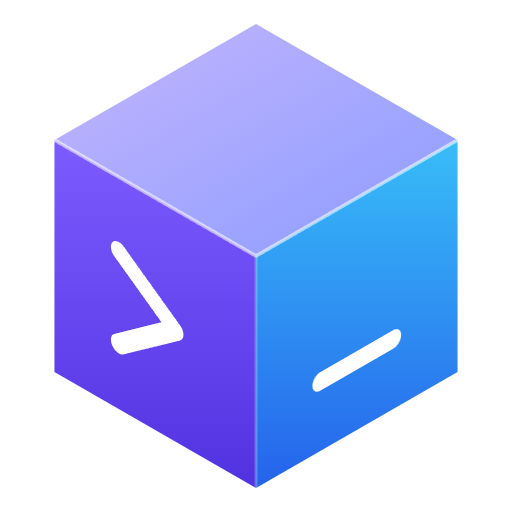
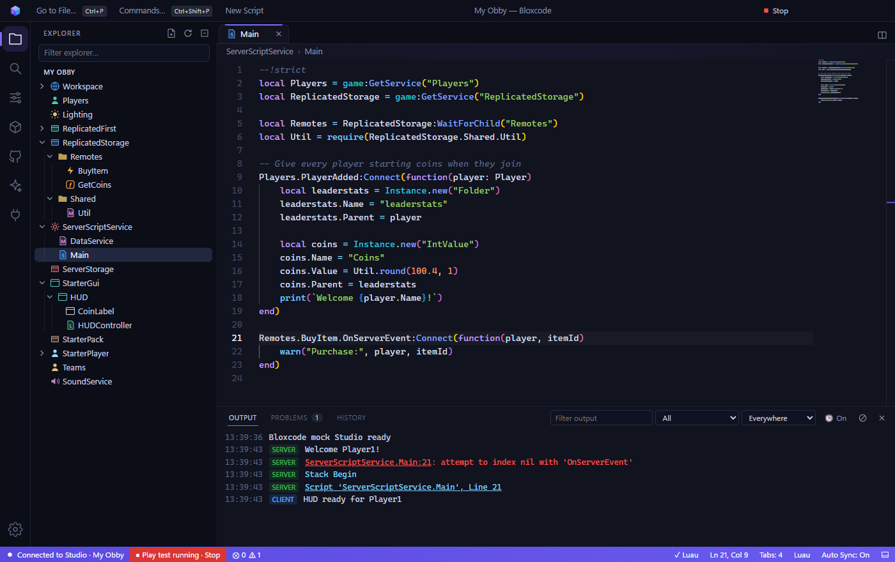

<p align="center">
  
</p>

<h1 align="center">Bloxcode</h1>

<p align="center">
  <b>Write Roblox code like in VS Code.</b><br>
  An external code editor for Roblox Studio with a live Explorer, two-way sync and built-in Wally packages.
</p>

<p align="center">
  <a href="https://bloxcode-docs.seidl.workers.dev/download/windows"><b>Download for Windows</b></a> ·
  <a href="https://bloxcode-docs.seidl.workers.dev/download/mac"><b>Download for Mac</b></a> ·
  <a href="https://bloxcode-docs.seidl.workers.dev/docs/intro">Getting started</a> ·
  <a href="https://bloxcode-docs.seidl.workers.dev">Website</a>
</p>



## Features

- **Code Mode:** turn it on in the Studio plugin and every script you open in Studio opens in Bloxcode instead.
- **Live Explorer:** Workspace, ServerScriptService, ReplicatedStorage, StarterGui and more, mirrored in real time. Create, rename, move (drag & drop), duplicate and delete objects.
- **Two-way sync:** what you type goes to Studio right away, and changes in Studio show up in Bloxcode. Every change is one undo step in Studio.
- **Wally packages:** search and install Cmdr, Knit, Promise, Fusion and more with one click, dependencies included.
- **Luau editor:** Monaco (the editor behind VS Code) with Luau highlighting, snippets and autocomplete that knows your Explorer.
- **Code with Claude:** chat with Claude right in Bloxcode (with your Claude plan through Claude Code, or your own API key) and it builds features right inside your place: reads the Explorer and scripts, writes code, creates instances, installs packages and reads the Output after you play-test. See [Code with Claude](https://bloxcode-docs.seidl.workers.dev/docs/claude).
- **Auto updates:** Bloxcode updates itself on startup, like Discord.

## How it works

```
Roblox Studio                          Bloxcode (Electron)
┌───────────────────────┐   HTTP     ┌──────────────────────────┐
│ BloxcodeBridge plugin │ ─────────▶ │ local server :34872      │
│  · mirrors Explorer   │  events    │  · Explorer tree         │
│  · intercepts opens   │ ◀───────── │  · Monaco editor tabs    │
│  · runs commands      │  commands  │  · Wally package manager │
└───────────────────────┘ (long poll)└──────────────────────────┘
```

The Studio plugin is the client: it posts Explorer changes to Bloxcode and long-polls for commands (set source, create, rename, install package, …). See the [Protocol reference](https://bloxcode-docs.seidl.workers.dev/api/Protocol).

## Project layout

| Path | What it is |
| --- | --- |
| `app/main.js` | Electron main process and the local HTTP bridge |
| `app/updater.js` | Splash window and auto-updater |
| `app/packages.js` | Wally registry client, dependency resolution, Rojo-style file conversion |
| `app/studio.js` | The shared copy of the place: Explorer tree, script sources, Output, requests to the plugin |
| `app/lsp.js` | Luau language server (luau-lsp): workspace mirror, sourcemap, diagnostics |
| `app/search.js` · `app/history.js` | Search & replace in all scripts, local script history |
| `app/github.js` · `app/discord.js` · `app/playtest.js` | GitHub publishing, Discord Rich Presence, play tests |
| `app/agent.js` | Tools for Claude: Explorer mirror, output log, requests to the plugin, Claude config setup |
| `app/chat.js` | In-app chat: runs Claude Code (`claude -p`) with the Bloxcode MCP server, or the agent loop with an API key |
| `app/mcp/bloxcode-mcp.js` | MCP server Claude starts (runs with the Bloxcode executable in Node mode, no dependencies); also exports the tool list for the chat |
| `app/renderer/` | The editor UI (Monaco, Explorer, tabs, package view) |
| `studio-plugin/src/CodeBridge.lua` | The Roblox Studio plugin |
| `studio-plugin/docs`, `pages`, `.moonwave` | Website and docs (Moonwave) |
| `studio-plugin/worker.js` | Cloudflare Worker: website, update feed, download link |
| `tools/` | Mock Studio for testing, release script, icon generator |

## Development

Requires Node.js 20+ on Windows or macOS. Build the Mac app with `npm run dist:mac` (universal: Apple Silicon + Intel). On a Mac, build outside `~/Documents`, for example `npx electron-builder --mac --universal -c.directories.output=/tmp/bloxcode-dist`, because Finder metadata there breaks code signing. Publish with `BLOXCODE_DIST=/tmp/bloxcode-dist npm run release:mac`.

```bash
npm install
npm start
```

Test without Roblox Studio by running a fake Studio that connects to the app:

```bash
node tools/mock-studio.js
```

The fake Studio also answers Claude's tool calls. To try the MCP server by hand, point it at the dev copy: `BLOXCODE_PORT=34999 BLOXCODE_KEY_FILE=%APPDATA%/bloxcode-dev/agent-key.txt node app/mcp/bloxcode-mcp.js`.

To run a dev copy next to an installed Bloxcode, give it its own port: `BLOXCODE_PORT=34999 npm start` (and the same for the mock).

## Releasing

1. Bump `version` in `package.json` and add the release to `app/renderer/changelog.js` and `release-notes/<version>.md`.
2. Run `npm run release`. This builds the installer (signed if set up, see [SIGNING.md](SIGNING.md)) and uploads it to the update server.
3. Push a tag (`git tag v2.0.0 && git push --tags`). GitHub Actions builds the installer and publishes a GitHub Release.

Installed copies update themselves on their next start.

## Website

```bash
npm run docs:build
npm run docs:deploy
```

The website is built with [Moonwave](https://eryn.io/moonwave/) and hosted on Cloudflare Workers. Installers live in the R2 bucket `bloxcode-releases` and are served at `/updates/` and `/download`.

## License

[MIT](LICENSE)
<p align="center">
  <b>Write Roblox code like in VS Code.</b><br>
  The modern code editor for Roblox Studio: live sync, real Luau type checking, play tests, search across every script, GitHub and Claude built in.
</p>

<p align="center">
  <a href="https://bloxcode-docs.seidl.workers.dev/download/windows"><b>Download for Windows</b></a> ·
  <a href="https://bloxcode-docs.seidl.workers.dev/docs/intro">Getting started</a> ·
  <a href="https://bloxcode-docs.seidl.workers.dev/changelog">Changelog</a> ·
  <a href="https://bloxcode-docs.seidl.workers.dev">Website</a>
</p>


## Features

- **Code Mode:** every script you open in Studio opens in Bloxcode instead, and everything syncs both ways. Every change is one undo step in Studio.
- **Live Explorer** with create, rename, drag & drop, error counts and a **Properties** panel for properties, attributes and tags.
- **Luau type checking** with [luau-lsp](https://github.com/JohnnyMorganz/luau-lsp): errors while you type, hover docs, Go to Definition, Find References and Rename across scripts.
- **Play tests from Bloxcode** (Play, Run, Stop) with a **test mode** window, an **Output** panel with clickable errors and a **Problems** panel.
- **Search & Replace** in all scripts, a **command palette**, a **split editor** and **script history** with diff and restore.
- **11 themes** (Bloxcode Night and Day, Dark+, Roblox Studio Dark, Dracula, …), any accent color, fonts, and VS Code theme import.
- **Wally packages** with one click, dependencies included.
- **GitHub:** create a repository and publish your scripts with one click (Rojo-compatible layout).
- **Code with Claude:** chat with Claude in Bloxcode or use Claude Desktop. 34 MCP tools, resources and prompts: Claude reads your game, writes code, builds GUIs, runs play tests, checks types and fixes its own errors. Optional review of every change. See [Code with Claude](https://bloxcode-docs.seidl.workers.dev/docs/claude).
- **Auto updates:** Bloxcode updates itself on startup, like Discord.

 on startup, like Discord.

## How it works

```
Roblox Studio                          Bloxcode (Electron)
┌───────────────────────┐   HTTP     ┌──────────────────────────┐
│ BloxcodeBridge plugin │ ─────────▶ │ local server :34872      │
│  · mirrors Explorer   │  events    │  · Explorer tree         │
│  · intercepts opens   │ ◀───────── │  · Monaco editor tabs    │
│  · runs commands      │  commands  │  · Wally package manager │
└───────────────────────┘ (long poll)└──────────────────────────┘
```

The Studio plugin is the client: it posts Explorer changes to Bloxcode and long-polls for commands (set source, create, rename, install package, …). See the [Protocol reference](https://bloxcode-docs.seidl.workers.dev/api/Protocol).

## Project layout

| Path | What it is |
| --- | --- |
| `app/main.js` | Electron main process and the local HTTP bridge |
| `app/updater.js` | Splash window and auto-updater |
| `app/packages.js` | Wally registry client, dependency resolution, Rojo-style file conversion |
| `app/agent.js` | Tools for Claude: Explorer mirror, output log, requests to the plugin, Claude config setup |
| `app/chat.js` | In-app chat: runs Claude Code (`claude -p`) with the Bloxcode MCP server, or the agent loop with an API key |
| `app/mcp/bloxcode-mcp.js` | MCP server Claude starts (runs with the Bloxcode executable in Node mode, no dependencies); also exports the tool list for the chat |
| `app/renderer/` | The editor UI (Monaco, Explorer, tabs, package view) |
| `studio-plugin/src/CodeBridge.lua` | The Roblox Studio plugin |
| `studio-plugin/docs`, `pages`, `.moonwave` | Website and docs (Moonwave) |
| `studio-plugin/worker.js` | Cloudflare Worker: website, update feed, download link |
| `tools/` | Mock Studio for testing, release script, icon generator |

## Development

Requires Node.js 20+ on Windows or macOS. Build the Mac app with `npm run dist:mac` (universal: Apple Silicon + Intel). On a Mac, build outside `~/Documents`, for example `npx electron-builder --mac --universal -c.directories.output=/tmp/bloxcode-dist`, because Finder metadata there breaks code signing. Publish with `BLOXCODE_DIST=/tmp/bloxcode-dist npm run release:mac`.

```bash
npm install
npm start
```

Test without Roblox Studio by running a fake Studio that connects to the app:

```bash
node tools/mock-studio.js
```

The fake Studio also answers Claude's tool calls. To try the MCP server by hand, point it at the dev copy: `BLOXCODE_PORT=34999 BLOXCODE_KEY_FILE=%APPDATA%/bloxcode-dev/agent-key.txt node app/mcp/bloxcode-mcp.js`.

To run a dev copy next to an installed Bloxcode, give it its own port: `BLOXCODE_PORT=34999 npm start` (and the same for the mock).

## Releasing

1. Bump `version` in `package.json`.
2. Run `npm run release`. This builds the installer and uploads it to the update server.

Installed copies update themselves on their next start.

## Website

```bash
npm run docs:build
npm run docs:deploy
```

The website is built with [Moonwave](https://eryn.io/moonwave/) and hosted on Cloudflare Workers. Installers live in the R2 bucket `bloxcode-releases` and are served at `/updates/` and `/download`.

## License

[MIT](LICENSE)
